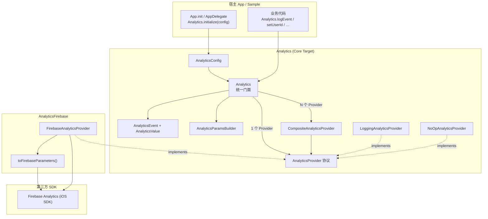
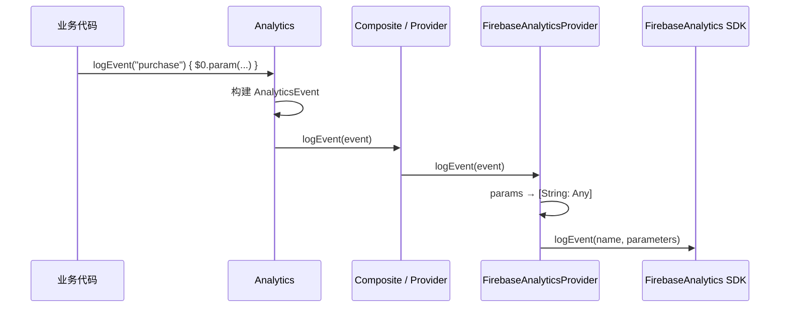

# AnalyticsKit (iOS)

iOS 统一统计封装库：业务只依赖统一 API，底层可插拔接入 Firebase Analytics 等 SDK。

## 架构



### 调用链（事件上报）



## 模块

| Product / Target | 说明 |
|------|------|
| `Analytics` | 核心 API、`AnalyticsProvider` 协议、Composite / Logging / NoOp，零三方依赖 |
| `AnalyticsFirebase` | Firebase 适配器；依赖 Google `firebase-ios-sdk` |
| `Sample` | SwiftUI 示例工程代码（演示 Logging + Firebase） |

## 安装接入 (Swift Package Manager)

### Package.swift 方式

在你的 `Package.swift` 中添加依赖：

```swift
dependencies: [
    .package(url: "https://github.com/e-hai/AnalyticsKit.git", branch: "ios")
],
targets: [
    .target(
        name: "YourAppTarget",
        dependencies: [
            // 仅使用核心能力
            .product(name: "Analytics", package: "AnalyticsKit"),
            // 若接入 Firebase 则同时引入
            .product(name: "AnalyticsFirebase", package: "AnalyticsKit"),
        ]
    )
]
```

### Xcode GUI 方式

1. 在 Xcode 中打开项目，选择 **File** → **Add Package Dependencies...**
2. 输入仓库地址：`https://github.com/e-hai/AnalyticsKit.git`
3. 分支选择 `ios`
4. 勾选需要的目标产物：`Analytics` 和（可选）`AnalyticsFirebase`

## 快速开始

### 1. 初始化

在应用启动入口（如 SwiftUI 的 `@main struct App` 或 `AppDelegate`）完成初始化：

```swift
import SwiftUI
import Analytics
import AnalyticsFirebase
import FirebaseCore // 如果使用 Firebase

@main
struct MyApp: App {
    init() {
        // 如果接入 Firebase
        FirebaseApp.configure()

        Analytics.initialize(
            config: AnalyticsConfig(
                providers: [
                    LoggingAnalyticsProvider(),   // 调试输出 (OSLog / 控制台)
                    FirebaseAnalyticsProvider(),  // 生产环境 Firebase
                ],
                enabled: true,
                debug: true // 开启失败日志与警告
            )
        )
    }

    var body: some Scene {
        WindowGroup {
            ContentView()
        }
    }
}
```

### 2. 埋点与事件追踪

```swift
import Analytics

// 闭包 Builder 链式打点
Analytics.logEvent("purchase") {
    $0.param("item_id", "sku_1001")
      .param("price", 99.9)
      .param("quantity", 1)
      .param("is_vip", true)
}

// 页面浏览记录
Analytics.logScreenView(screenName: "HomeVC", screenClass: "HomeViewController")

// 用户身份标识与用户属性
Analytics.setUserId("user_1024")
Analytics.setUserProperty(name: "membership", value: "diamond")

// 动态开关上报采集（例如合规授权）
Analytics.setEnabled(false)

// 登出重置清理
Analytics.reset()
```

## Firebase 配置说明

1. 前往 [Firebase Console](https://console.firebase.google.com/) 创建并注册 iOS 应用（填写对应的 Bundle Identifier）。
2. 下载 `GoogleService-Info.plist` 并添加到 Xcode 主 Target 的根目录下。
3. 保证应用入口首先调用 `FirebaseApp.configure()`。

## 扩展自定义 Provider

接入新厂商（例如 AppsFlyer、Mixpanel 等）只需实现 `AnalyticsProvider` 协议：

```swift
import Analytics

public final class MyCustomProvider: AnalyticsProvider, @unchecked Sendable {
    public let name: String = "my_vendor"

    public func initialize() {
        // 初始化厂商 SDK
    }

    public func logEvent(_ event: AnalyticsEvent) {
        // 将 event.name 和 event.params 映射到厂商 API
    }

    public func setUserId(_ userId: String?) { ... }
    public func setUserProperty(name: String, value: String?) { ... }
    public func setAnalyticsCollectionEnabled(_ enabled: Bool) { ... }
    public func resetAnalyticsData() { ... }
}
```

并在 `AnalyticsConfig(providers: [...])` 中注册即可。
