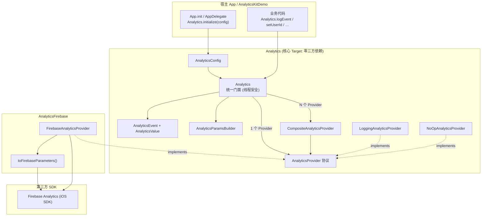
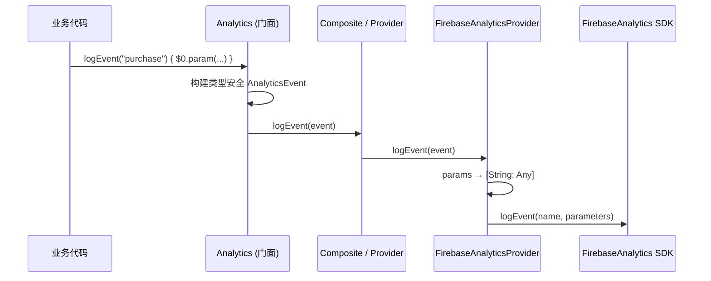

# AnalyticsKit-iOS

iOS / Apple 平台统一统计封装库：业务代码面向统一 API 编程，底层可插拔接入 Firebase Analytics 等 SDK。支持单通道与多通道同时广播分发，具备强大的 Fail-Soft 容错能力与并发线程安全。

---

## 特性亮点

- **统一门面 API**：业务层调用统一的 `Analytics.*`，彻底解耦第三方 SDK 实现细节。
- **强类型参数体系**：通过枚举密封类型 `AnalyticsValue`（String、Int64、Double、Bool），杜绝无约束的 `[String: Any]` 导致的特定厂商序列化异常或 Crash。
- **链式闭包 DSL**：提供符合 Swift 习惯的参数构建器 `Analytics.logEvent("name") { $0.param(...) }`。
- **Fail-Soft 容错多通道**：通过 `CompositeAnalyticsProvider` 支持多厂商同时分发，单个 Provider 异常被独立捕获，宿主 App 业务流程绝对不因埋点崩溃。
- **零三方依赖核心库**：`Analytics` 核心 Target 无任何外部依赖；`AnalyticsFirebase` 独立封装 Google `firebase-ios-sdk`。
- **现代 Swift 规范**：完整支持 Swift 5.9+ / Swift 6，遵循 `Sendable` 并发安全与线程安全锁保护。
- **配套 Demo App**：内置由 SwiftUI 打造的交互式 Demo 工程（`AnalyticsKitDemo.xcodeproj`），一键在模拟器中运行体验。

---

## 架构



### 调用链路



---

## 模块与产物

| Target / Library | 说明 | 适用场景 |
| :--- | :--- | :--- |
| **`Analytics`** | 核心 API、`AnalyticsProvider` 协议、Composite / Logging / NoOp | 自建统计上报、或仅使用本地日志调试 / 扩展其他厂商 |
| **`AnalyticsFirebase`** | Firebase 适配器；依赖并集成 Google `firebase-ios-sdk` | 需要上报至 Google Firebase Analytics |
| **`Sample` (Demo App)**| 基于 SwiftUI 构建的可视化演示应用 | 体验打点、参数与控制台日志输出 |

### 最低系统支持

- **iOS** 13.0+
- **macOS** 12.0+
- **tvOS** 13.0+
- **watchOS** 6.0+

---

## 安装接入 (Swift Package Manager)

### 方式 A：Package.swift 声明

在您项目的 `Package.swift` 中添加：

```swift
dependencies: [
    .package(url: "https://github.com/e-hai/AnalyticsKit-iOS.git", from: "1.0.0")
],
targets: [
    .target(
        name: "YourAppTarget",
        dependencies: [
            // 核心功能 (零外部依赖)
            .product(name: "Analytics", package: "AnalyticsKit-iOS"),
            // 若接入 Firebase 则同时引入
            .product(name: "AnalyticsFirebase", package: "AnalyticsKit-iOS"),
        ]
    )
]
```

### 方式 B：Xcode GUI 添加

1. 在 Xcode 中打开您的主项目，选择菜单 **File** → **Add Package Dependencies...**
2. 搜索框输入仓库地址：`https://github.com/e-hai/AnalyticsKit-iOS.git`
3. Dependency Rule 选择 **Up to Next Major Version**（`1.0.0`）
4. 在弹出的模块列表中勾选需要的目标产物：`Analytics` 和（可选）`AnalyticsFirebase`。

---

## 快速开始

### 1. 初始化

在应用启动入口（如 SwiftUI 的 `@main struct App` 或 `AppDelegate`）完成初始化：

```swift
import SwiftUI
import Analytics
import AnalyticsFirebase
import FirebaseCore // 如果使用 Firebase

@main
struct MyApp: App {
    init() {
        // 如果接入了 Firebase
        FirebaseApp.configure()

        Analytics.initialize(
            config: AnalyticsConfig(
                providers: [
                    LoggingAnalyticsProvider(),   // 调试输出 (OSLog / 控制台)
                    FirebaseAnalyticsProvider(),  // 生产环境 Firebase
                ],
                enabled: true,
                debug: true // 开启调试模式输出失败诊断
            )
        )
    }

    var body: some Scene {
        WindowGroup {
            ContentView()
        }
    }
}
```

### 2. 事件打点与追踪

```swift
import Analytics

// 1. 闭包链式打点 (强类型安全)
Analytics.logEvent("purchase") {
    $0.param("item_id", "sku_1001")
      .param("price", 99.9)
      .param("quantity", 1)
      .param("is_vip", true)
}

// 2. 页面访问追踪
Analytics.logScreenView(screenName: "HomeVC", screenClass: "HomeViewController")

// 3. 用户身份标识与用户属性
Analytics.setUserId("user_1024")
Analytics.setUserProperty(name: "membership", value: "diamond")

// 4. 动态开关上报采集 (例如 ATT / GDPR 授权状态切换)
Analytics.setEnabled(false)

// 5. 用户登出时数据清理
Analytics.reset()
```

---

## Firebase 配置说明

若使用 `AnalyticsFirebase`：

1. 前往 [Firebase Console](https://console.firebase.google.com/) 创建并注册 iOS 应用（Bundle ID 必须与主工程严格一致）；
2. 下载 `GoogleService-Info.plist` 并添加到 Xcode 主 Target 根目录下；
3. 确保在 `Analytics.initialize` 之前先调用 `FirebaseApp.configure()`。

---

## 运行内置 Demo 工程

项目内自带一个完整的 SwiftUI 交互式演示工程：

1. 双击打开 `AnalyticsKitDemo.xcodeproj`；
2. 顶部 Scheme 选择 **`AnalyticsKitDemo`**；
3. 目标设备选择任一 **iOS 模拟器**（如 iPhone 16 Pro）；
4. 按下快捷键 **`Cmd + R`** 即可在模拟器中体验可视化交互与事件日志查看。

---

## 扩展自定义 Provider

接入新厂商（例如 AppsFlyer、Mixpanel 等）只需实现 `AnalyticsProvider` 协议：

```swift
import Analytics

public final class CustomAnalyticsProvider: AnalyticsProvider, @unchecked Sendable {
    public let name: String = "custom_vendor"

    public func initialize() {
        // 初始化厂商 SDK
    }

    public func logEvent(_ event: AnalyticsEvent) {
        // 将 event.params (AnalyticsValue) 转换为目标厂商数据格式并上报
    }

    public func setUserId(_ userId: String?) { ... }
    public func setUserProperty(name: String, value: String?) { ... }
    public func setAnalyticsCollectionEnabled(_ enabled: Bool) { ... }
    public func resetAnalyticsData() { ... }
}
```

并在 `AnalyticsConfig(providers: [...])` 中挂载注册即可，门面会自动统一调度分发。

---

## 许可证

本项目基于 [Apache License 2.0](http://www.apache.org/licenses/LICENSE-2.0.txt) 协议开源。
